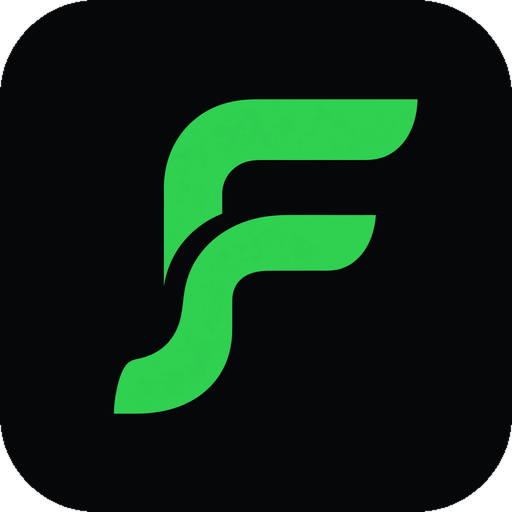

  

<h1 align="center">fluyeporlaweb</h1>

<strong>Open-source marketing tools &amp; AI workflows</strong>

  Tools and curated lists that help brands, growth teams and creators get discovered. 
  <em>Herramientas open source de marketing y flujos de IA.</em>

  <a href="https://fluyeporlaweb.com">Website</a>
  &nbsp;·&nbsp;
  <a href="https://github.com/fluyeporlaweb">GitHub</a>
  &nbsp;·&nbsp;
  <a href="https://x.com/fluyeporlaweb">X @fluyeporlaweb</a>
  &nbsp;·&nbsp;
  <a href="https://t.me/fluyeporlaweb">Telegram</a>
  &nbsp;·&nbsp;
  <a href="https://fluyeporlaweb.com/patrocina">Sponsor</a>
  &nbsp;·&nbsp;
  

## Featured

<table>
  <tr>
    <td align="center" valign="top" width="33%">
      
      <h3><a href="https://github.com/fluyeporlaweb/prospectforge">prospectforge</a></h3>
      
Open-source B2B lead pipeline: discover, qualify against your ICP, draft outreach. Dry-run by default. Never sends email.

      

        
        
      

    </td>
    <td align="center" valign="top" width="33%">
      
      <h3><a href="https://github.com/fluyeporlaweb/awesome-design-stack">awesome-design-stack</a></h3>
      
Curated web design resources for people who ship: landings, pricing pages, onboarding, email and design systems. English &amp; Español.

      

        
        
      

    </td>
    <td align="center" valign="top" width="33%">
      
      <h3><a href="https://github.com/fluyeporlaweb/ai-agent-tools">ai-agent-tools</a></h3>
      
Curated directory of open-source AI tools for marketing and agents: MCP servers, skills, SDKs and workflows.

      

        
        
      

    </td>
  </tr>
</table>

## Sponsor

To sponsor a list, feature your brand, or start a collaboration, write to [colab@fluyeporlaweb.com](mailto:colab@fluyeporlaweb.com) or visit [fluyeporlaweb.com/patrocina](https://fluyeporlaweb.com/patrocina).

## Links

- Website: [fluyeporlaweb.com](https://fluyeporlaweb.com)
- GitHub: [github.com/fluyeporlaweb](https://github.com/fluyeporlaweb)
- X: [@fluyeporlaweb](https://x.com/fluyeporlaweb)
- Telegram: [t.me/fluyeporlaweb](https://t.me/fluyeporlaweb)
- Email: [colab@fluyeporlaweb.com](mailto:colab@fluyeporlaweb.com)
